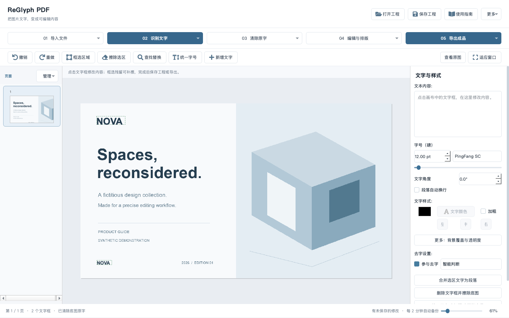
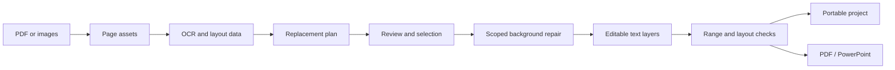

<p align="center"></p>
<h1 align="center">ReGlyph PDF</h1>
<p align="center"><strong>Precision text editing for image PDFs.</strong><br>Recognize text, repair the background, and keep the rest of the page intact.</p>
<p align="center"><a href="README.zh-CN.md">简体中文</a> · <a href="#quick-start">Quick start</a> · <a href="docs/user-guide.md">User guide</a> · <a href="docs/architecture.md">Architecture</a></p>

ReGlyph PDF is a local-first desktop application for editing text embedded in scanned PDFs, flattened brochures, and images. It combines OCR, region-scoped background repair, and editable text layers in a visual workspace, with exports to PDF and PowerPoint.

Its editing workflow is built around explicit scope: inspect a replacement plan, select the changes, repair only the approved regions, and verify the result before committing it. Original page assets remain available inside a portable project for comparison and continued editing.



## Why ReGlyph PDF

- **Edit image-backed text.** Detect text with PaddleOCR, clear the original lettering, and place editable text over the repaired background.
- **Replace precisely.** Preview page-by-page matches, select individual changes, and preserve unrelated original content. Strict mode sends uncertain detections and mixed-text lines to review.
- **Repair within a defined region.** Use fast solid-color reconstruction for simple areas and LaMa inpainting for textured backgrounds. Model output outside the binary edit mask is discarded.
- **Keep edits recoverable.** Save original images, repaired backgrounds, and text properties in a self-contained `.ipdfedit` project. Undo, redo, and automatic recovery support iterative editing.
- **Control typography.** Adjust position, font, point size, color, alignment, and rotation; merge text lines into paragraphs and apply consistent sizes by text role.
- **Export for the next workflow.** Create a PDF with editable text layers or a PowerPoint presentation with native text boxes.
- **Run locally.** OCR and the bundled repair service run on your computer. Content-addressed caching, bounded crop batching, and conservative CPU defaults reduce repeated computation.

## Business workflows

| Scenario | Typical task | Deliverable |
| --- | --- | --- |
| Brand refresh | Replace approved names, page footers, and image-backed wordmarks across existing collateral | Updated brochure PDF and an editable project |
| Sales and marketing | Adapt a presentation or flattened product sheet for another audience | Editable PowerPoint and a distribution PDF |
| Product catalog maintenance | Correct model numbers, specifications, captions, or contact information in selected regions | Revised catalog pages with preserved surrounding imagery |
| Document localization | Replace selected passages with reviewed translated copy and adjust typography | Localized PDF or presentation |
| Template recovery | Reconstruct editable text from scans and flattened artwork | A reusable project containing page assets and editable text boxes |

## Quick start

**Runtime:** Python **3.11**, macOS or Windows x64. Apple Silicon machines, including M1/M2-class devices and newer configurations, are within the intended operating range. Resource needs depend on page resolution, batch size, and repair regions; see [installation and hardware guidance](docs/installation.md).

```bash
git clone https://github.com/15016623369a-spe/reglyph-pdf.git
cd reglyph-pdf
```

### macOS

```bash
python3.11 bootstrap.py
./launch.command
```

### Windows

```powershell
py -3.11 bootstrap.py
.\launch.bat
```

The installer creates separate editing/OCR and image-repair environments. Model weights are downloaded on first use and reused locally. The launch scripts start the editor and its loopback-only repair service; close the application to stop the service started by that launch.

For an existing editing environment, use `python launcher.py`. Use `python launcher.py --check` to verify editor dependencies and the local repair service.

## Editing workflow

1. **Import** a PDF or images, then save a project copy.
2. **Recognize** the current page or all pages. OCR provides text and location data.
3. **Preview** find-and-replace operations. Keep strict mode enabled and review the page, original text, replacement, and processing status.
4. **Apply** the selected operations. The tool repairs the permitted background regions and updates the corresponding text boxes.
5. **Inspect** the result at an appropriate zoom. Use a local touch-up for remaining image-backed lettering, and adjust typography as needed.
6. **Save and export** the portable project, PDF, or PowerPoint.

For replacements such as `ACME → NOVA`, strict mode automatically processes clear, independently located text boxes. A brand word embedded in an OCR line is left for review when precise word coordinates are unavailable; it is not located by dividing the line into character-width estimates. Exported editability applies to the text layers you reconstruct, while untouched page content remains image-backed.

### Change integrity

- A preview binds the operation to a document fingerprint, selected text boxes, and permitted regions.
- Stale plans are rejected after the document changes.
- Repaired background pixels outside the permitted regions must remain identical.
- Expected text and layout changes are checked before a strict replacement is committed.
- A failed or canceled replacement batch restores the previous document and undo/redo history.
- Each committed strict replacement writes a JSON operation record with the plan, applied count, review items, and validation result.

See [the editing guide](docs/user-guide.md) for mixed-text lines, local touch-ups, typography, and project recovery.

## Technology

| Layer | Technology | Responsibility |
| --- | --- | --- |
| Desktop workspace | Python 3.11, PySide6 / Qt, QtAwesome | Canvas, text editing, page navigation, dialogs and export rendering |
| OCR | PaddleOCR, PaddlePaddle | Text detection, recognition, bounding regions and confidence |
| Image processing | OpenCV, NumPy, Pillow | Mask construction, background analysis, local repair and pixel comparison |
| Background repair | IOPaint, LaMa, PyTorch | Local image inpainting behind a loopback HTTP service |
| Document output | PyMuPDF, Qt PDF rendering, python-pptx | PDF import, layered PDF output and native PPTX text boxes |
| Project persistence | JSON, ZIP, SHA-256 | Portable assets, document fingerprints, repair cache and operation records |
| Quality checks | unittest, Qt integration tests, GitHub Actions | Contract validation, transaction recovery and desktop dependency checks |

## Architecture



The GUI, edit contract, repair worker, and export layer are separated into modules. Repair requests use cropped context while retaining the exact edit mask. See [architecture and project structure](docs/architecture.md).

## Configuration

The default compute budget is **2 CPU threads**. Set `IPDF_CPU_THREADS` to `1`–`4` before launching to tune the budget for the available hardware. Higher-end devices use the same workflow and file format; processor-specific builds are not required for supported platforms.

| Setting | Purpose |
| --- | --- |
| `IPDF_CPU_THREADS` | CPU thread budget for local numerical work |
| `IPDF_DATA_DIR` | Override the per-user settings, cache, recovery and operation-record directory |
| `IPDF_MODEL_DIR` | Override the model cache directory |
| `IPDF_EDITOR_PYTHON` | Use a specific editing environment |
| `IPDF_REPAIR_PYTHON` | Use a specific image-repair environment |

The repair service listens on `127.0.0.1:18181`. An existing compatible repair endpoint can be configured through the editor settings. Standard local operation does not require an API key or a cloud language model.

## Development and testing

```bash
python tests/test_contract.py
python tests/test_platform.py
python tests/test_desktop.py
python tests/test_project_export.py
```

The desktop tests generate synthetic fixtures locally. They exercise strict matching, partial selection, unrelated-pixel preservation, stale plans, undo/redo, failure and cancellation recovery, project persistence, and document export. CI separates the editor and repair environments and checks the macOS and Windows desktop workflows.

See [CONTRIBUTING.md](CONTRIBUTING.md) for environment setup and review expectations, and [SECURITY.md](SECURITY.md) for handling document data and security reports.

## Project and maintenance

ReGlyph PDF is developed and maintained by [Jace hj](https://github.com/15016623369a-spe). The project brings document recognition, precise replacement, local image repair, and editable export into a dedicated desktop workspace for document production teams.

For component credits and source terms, see [Third-party notices](THIRD_PARTY_NOTICES.md).

All examples and screenshots in this repository use synthetic content.
