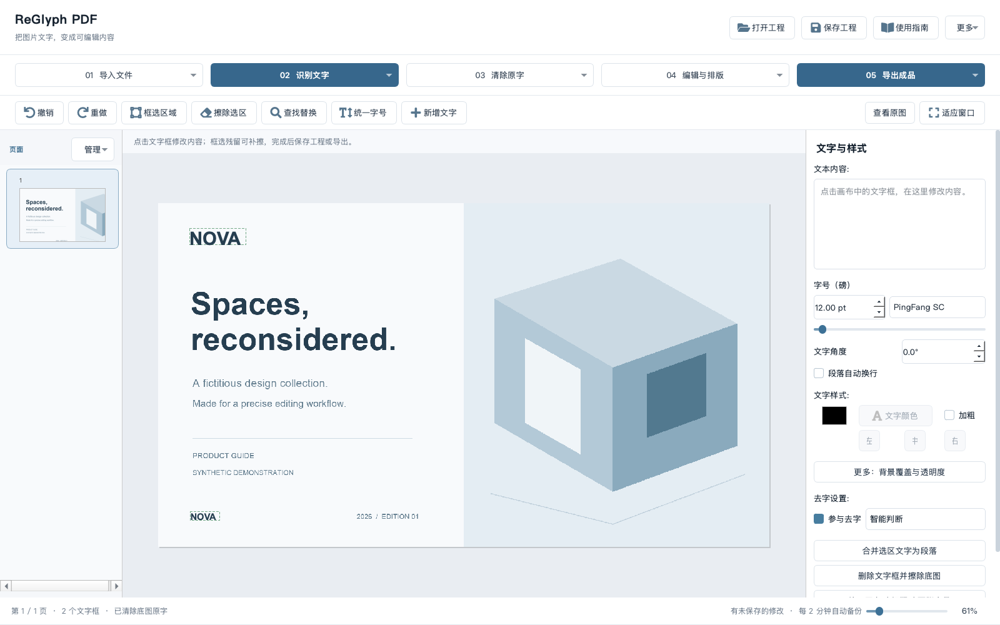

<p align="center"></p>
<h1 align="center">ReGlyph PDF</h1>
<p align="center"><strong>让图片 PDF 中的文字重新可编辑。</strong><br>识别文字、局部修复底图，并保留其他原版内容。</p>
<p align="center"><a href="README.md">English</a> · <a href="#快速开始">快速开始</a> · <a href="docs/user-guide.zh-CN.md">使用指南</a> · <a href="docs/architecture.md">技术架构</a></p>

ReGlyph PDF 是一款以本地处理为默认方式的桌面文字编辑工具，适用于扫描 PDF、扁平化宣传册和图片中的文字修改。它将 OCR 识别、限定区域的底图修复和可编辑文字图层整合到同一个工作台，支持保存工程，并导出 PDF 与 PowerPoint。

工作流围绕明确的修改范围展开：先预览计划，再选择项目；只处理选定区域，校验后提交。原始页面与修复后的底图共同保存在工程中，便于对照、撤销和继续修改。



## 核心能力

- **图片文字编辑**：通过 PaddleOCR 识别文字和坐标，清除底图旧字，再放入可编辑的文字框。
- **精确批量替换**：逐项预览页码、原文字和新文字，可单独勾选处理项；严格模式将混合正文或识别不确定的内容交由人工核对。
- **限定区域修复**：简单背景优先快速清除，复杂纹理使用 LaMa 修复；修复结果只能写入明确的二值遮罩区域。
- **可恢复的工程**：将原图、修复底图、文字样式打包为 `.ipdfedit`，支持撤销、重做和自动备份。
- **文字排版**：调整位置、字体、字号、颜色、对齐和旋转；合并多行段落，按标题、正文和页脚统一字号。
- **多种输出**：导出带文字图层的 PDF，以及文字框可继续修改的 PowerPoint。
- **本地批处理优化**：局部裁剪、相邻区域合并、内容缓存与可调 CPU 线程预算，减少重复计算。

## 业务场景

| 场景 | 典型任务 | 输出 |
| --- | --- | --- |
| 品牌视觉更新 | 批量替换宣传物料中的品牌名称、页脚和图片字标 | 更新后的宣传册及可继续编辑的工程 |
| 市场与销售资料复用 | 调整产品介绍、客户演示、活动资料中的指定内容 | PDF 与可编辑 PowerPoint |
| 产品目录维护 | 修正产品型号、参数、说明、联系方式等局部文字 | 保留其他图像内容的新版目录 |
| 文档本地化 | 替换已审核的翻译文案并调整排版 | 本地化宣传页和演示文稿 |
| 图片模板恢复 | 将扫描件或扁平化页面中的文字重建为编辑对象 | 包含原始页面与文字图层的模板工程 |

## 快速开始

运行环境为 **Python 3.11**，支持 macOS 与 Windows x64。M1、M2 级别的 Apple Silicon 设备及更新配置属于预期运行范围；工具按通用桌面工作流设计，实际资源需求取决于分辨率、批量页数和修复区域大小。

```bash
git clone https://github.com/15016623369a-spe/reglyph-pdf.git
cd reglyph-pdf
```

macOS：

```bash
python3.11 bootstrap.py
./launch.command
```

Windows：

```powershell
py -3.11 bootstrap.py
.\launch.bat
```

安装程序分别建立编辑识别环境和图像修复环境，避免依赖冲突。首次使用会下载模型，此后复用本地模型。启动入口会打开编辑器及本机修复服务，关闭工具后，只结束本次启动的服务。

详细配置见 [安装与运行说明](docs/installation.md)。

## 标准工作流

1. **导入文件**：导入 PDF 或图片，先保存工程副本。
2. **识别文字**：识别本页或全部页面，获得文字与定位信息。
3. **预览修改**：输入查找与替换内容，保持严格模式，核对处理范围与匹配项目。
4. **执行选定项**：仅清除被允许位置的旧文字，并更新对应文字框。
5. **检查与排版**：放大检查照片招牌和残留区域，局部补擦，必要时统一字号和调整位置。
6. **保存与导出**：保存 `.ipdfedit` 工程，按用途导出 PDF 或 PowerPoint。

例如 `ACME → NOVA`：独立定位、识别清晰的文字框可进入自动替换；品牌混在整行正文中且缺少精确单词坐标时，会保留原样并列为待核对。工具不会按字符数量猜测擦除位置。导出的可编辑范围对应实际重建的文字图层，其余原版内容继续保留为底图。

## 修改完整性

- 修改计划绑定文档指纹、文字框和允许区域；文档变化后需重新预览。
- 清除后的底图在允许区域之外必须保持像素一致。
- 严格替换提交前检查文字内容和排版变化是否符合计划。
- 替换批次失败或取消时，恢复这批操作之前的文字、底图及撤销历史。
- 每次严格替换保存 JSON 操作记录，包含计划、已处理数量、待核对项和校验结果。

## 技术栈

| 层级 | 技术 | 用途 |
| --- | --- | --- |
| 桌面交互 | Python 3.11、PySide6 / Qt、QtAwesome | 页面导航、编辑画布、属性面板和交互流程 |
| 文字识别 | PaddleOCR、PaddlePaddle | 文字检测、识别、坐标与置信度 |
| 图像处理 | OpenCV、NumPy、Pillow | 遮罩、背景分析、快速清除与像素比较 |
| 图像修复 | IOPaint、LaMa、PyTorch | 本地背景修复 |
| 文档输出 | PyMuPDF、Qt PDF、python-pptx | PDF 导入、文字图层 PDF 与 PPTX 导出 |
| 工程与记录 | JSON、ZIP、SHA-256 | 原始资产、工程打包、文档指纹和修复缓存 |
| 测试与自动检查 | unittest、Qt 集成测试、GitHub Actions | 范围校验、事务恢复和桌面环境检查 |

## 资源配置

默认使用 **2 个 CPU 线程**。可通过 `IPDF_CPU_THREADS` 设置 `1`–`4` 的预算，按设备能力与任务规模调整。更高配置使用相同的功能和工程格式，无需针对特定处理器另建版本。

修复服务默认监听 `127.0.0.1:18181`；本地处理无需 API Key。设置、缓存、操作记录及自动备份存放于系统用户数据目录。更多参数见 [技术架构](docs/architecture.md)。

## 测试与参与开发

```bash
python tests/test_contract.py
python tests/test_platform.py
python tests/test_desktop.py
python tests/test_project_export.py
```

测试使用运行时生成的合成样本，覆盖精确匹配、勾选范围、区域外像素保留、文档变化检测、失败与取消回退、撤销重做、工程保存和导出。开发说明见 [CONTRIBUTING.md](CONTRIBUTING.md)。

## 项目与维护

ReGlyph PDF 由 [Jace hj](https://github.com/15016623369a-spe) 开发和维护，围绕文档制作中的实际需求，将文字识别、精确替换、局部图像修复与可编辑导出整合为完整的桌面工作流。

组件致谢与来源条款见 [第三方说明](THIRD_PARTY_NOTICES.md)。

仓库中的示例和截图全部使用合成内容。
